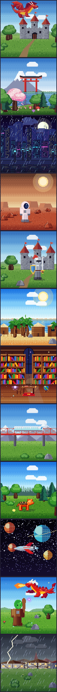
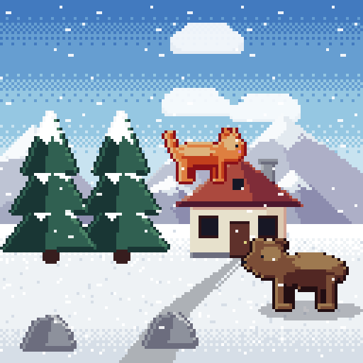
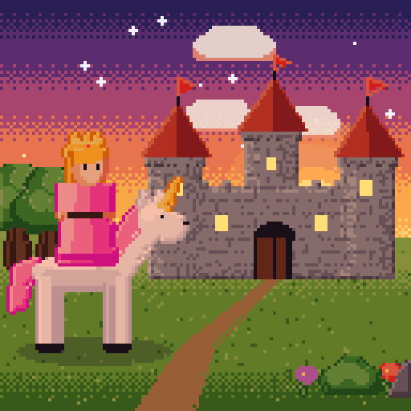

# PixelForge Studio

Generador de Pixel Art **por código**. Escribes una descripción («un dragón negro volando sobre una ciudad medieval con una luna roja»), un intérprete la convierte en un **plan de escena** (qué aparece, dónde, con qué jerarquía, paleta y luz), un **compositor** procedural la maqueta, un **control de calidad** mide el resultado y lo corrige, y un **motor gráfico propio** la dibuja en un Canvas. No hay filtros de pixelado ni modelos generativos de imágenes.

**Funciona sin internet, sin cuentas y sin claves.** La IA es opcional y local: un modelo de lenguaje en tu ordenador vía [Ollama](https://ollama.com) actúa como director artístico.



## Inicio rápido (Windows)

1. Instala [Node.js](https://nodejs.org) (LTS). No hace falta `npm install`.
2. Doble clic en **`INICIAR.bat`**. Si Ollama está instalado y no responde, lo arranca con `ollama serve` (nunca abre un segundo servidor si ya hay uno), espera a que esté listo y abre `http://localhost:8787`. Para cerrar PixelForge, **`DETENER.bat`** (no cierra Ollama).
3. **`COMPROBAR_OLLAMA.bat`**: estado de Ollama, modelos instalados, RAM y GPU.
4. **`PROBAR_OLLAMA.bat`**: prueba real completa con `qwen3.5:4b` (ver [Prueba real con Ollama](#prueba-real-con-ollama)).

Detalle en [GUIA_INSTALACION.md](GUIA_INSTALACION.md).

### Configuración por defecto

Pensada para un portátil con 16 GB de RAM y una GPU NVIDIA de 6 GB (por ejemplo, HP Victus con RTX 4050 Laptop):

| Ajuste | Valor | Dónde se cambia |
|---|---|---|
| Servidor de Ollama | `http://127.0.0.1:11434` | Panel «IA local» o `OLLAMA_URL` en `.env` |
| Modelo | `qwen3.5:4b` | Panel «IA local» o `PIXELFORGE_OLLAMA_MODEL` |
| Contexto | 4096 tokens (se amplía solo si el prompt no cabe, y se avisa) | Panel |
| Temperatura | 0,1 (antes 0,25: el mismo texto daba planes distintos) | Panel |
| Semilla del modelo | la misma de la imagen (campo «Semilla» y dado) | Panel principal |
| Mantener en memoria | 30 minutos (el modelo no se recarga en cada generación) | Panel |
| Servidor de PixelForge | solo `127.0.0.1` (no accesible desde la red) | `PIXELFORGE_HOST` |

Al abrir PixelForge con Ollama disponible, el modelo se precarga una vez. El panel muestra la GPU detectada (`nvidia-smi`) y qué parte del modelo está en la VRAM según Ollama (lo mismo que `ollama ps`).

En macOS o Linux: `npm start` dentro de esta carpeta.

## Motores

| Motor | Quién interpreta | Necesita | Cuándo usarlo |
|---|---|---|---|
| **Procedural offline** | Diccionarios, sinónimos y reglas semánticas | Nada | Siempre disponible, también en el móvil; instantáneo |
| **IA local · Ollama** | Un modelo de lenguaje en tu equipo | Ollama + un modelo | Descripciones libres, sinónimos, objetos fuera del catálogo |
| **Híbrido automático** (por defecto) | Ollama; si no responde, el procedural | Nada (usa Ollama si lo hay) | Recomendado: nunca se bloquea |
| Claude (nube) | — | — | **Desactivado.** El código se conserva inerte; solo se activaría con `PIXELFORGE_ENABLE_CLOUD=1` y una clave |

En el modo híbrido, lo que el parser reconoce con certeza y el modelo olvida se añade al plan, lo que protege frente a omisiones de modelos pequeños. El panel **«IA local (Ollama)»** muestra el estado, los modelos instalados, la memoria del equipo, el modelo recomendado y permite **evaluar** un modelo con medidas reales. Guía de modelos: [GUIA_MODELOS.md](GUIA_MODELOS.md).

El modelo **nunca dibuja ni devuelve código**: produce un plan JSON que se valida contra un esquema. Para lo que no existe en el catálogo usa **kits paramétricos** (humanoide, cuadrúpedo, edificio, volador, primitivas): un hada se construye como humanoide pequeño con alas y brillo, no se sustituye por un elfo.

## Qué sabe dibujar

- **Biblioteca de 139 elementos**: personajes (caballero, mago, hada, ángel, demonio, trol, orco, vampiro, bruja, arquero, vikingo…), animales y criaturas (tigre, elefante, jirafa, cebra, grifo, araña gigante, pingüino…), arquitectura (catedral, iglesia, palacio, mezquita, biblioteca, casa medieval, cabaña tropical, puente, muralla, fuente…), vehículos (tren clásico y futurista, nave espacial, submarino…), mobiliario de interiores y efectos (explosión, bola de fuego, magia, humo, rayo).
- **Interiores**: biblioteca, taberna, mazmorra, sala del trono, laboratorio y habitación, con ventanas, haces de luz y mobiliario.
- **Asentamientos**: ciudad medieval, aldea tropical en la playa, pueblo japonés, ciudad del desierto, aldea nórdica, con edificios de alturas variadas en dos planos.
- **Dirección artística**: protagonista con más peso visual, batallas cara a cara con pose de ataque, dirección de la luz con sombras coherentes, vista lateral, frontal, isométrica o panorámica, y 12 paletas temáticas con comprobación de coherencia (medieval, fantasía, oscuro, cyberpunk, tropical, invernal, desértico, espacial, japonés, retro, postapocalíptico, naturalista).
- **Resolución adaptativa**: con «Automática», las escenas sencillas usan 96 px y las complejas 128–160 px.

## Uso

1. **Describe la imagen** y pulsa **GENERAR** (Ctrl+Intro). Debajo aparece la *interpretación*: lo que el motor entendió, en texto y en forma compacta (`SUBJECT=dragon(red);SCENE=castle;LIGHT=night…`), y las palabras que no reconoció.
2. **VARIAR** muestra cuatro variaciones con otras semillas; **REGENERAR** repite con una semilla nueva. Con «fijar» activado, GENERAR reutiliza la semilla: la misma semilla produce siempre la misma imagen.
3. **Modificar la escena** acepta instrucciones como «conserva el castillo, cambia el cielo a púrpura y agrega una luna». Solo se regeneran las partes afectadas; el resto de capas —incluidas las que hayas editado a mano— se conserva.
4. **Panel de edición**: capas (mostrar, reordenar, opacidad, contorno, sombreado, duplicar, eliminar), paleta (cambiar un color actualiza toda la imagen porque todo se referencia por índice), luz (dirección, ambiente, dithering), exportación y el JSON editable.
5. **Lápiz, borrador y cuentagotas** para retoques píxel a píxel; se guardan en una capa propia.
6. **Guardar / Galería**: proyectos en IndexedDB, en tu dispositivo. Se pueden abrir, duplicar, renombrar, eliminar y exportar.

### Posición de los elementos

El motor procedural (y la IA local) entienden dónde quieres cada cosa (en español o inglés):

| Se escribe | Efecto |
|---|---|
| «a la izquierda», «a la derecha», «en el centro» | Lado del lienzo |
| «al fondo», «a lo lejos» / «en primer plano» | Más pequeño y alto / más grande y bajo |
| «encima de», «sobre» | Posado en el tejado, montado en un animal o sobrevolando |
| «detrás de» / «delante de», «frente a» | Se dibuja antes o después y se solapa |
| «junto a», «a la izquierda de…», «a la derecha de…» | Pegado al otro elemento |
| «debajo de» | Se interpreta al revés: el otro elemento queda encima |

Las relaciones se encadenan («un caballero sobre un caballo junto a una torre») y una segunda mención con artículo definido se refiere al mismo elemento («una casa… detrás de **la** casa»). Con «Modificar la escena» se pueden mover cosas ya generadas: «mueve el dragón a la izquierda». La interpretación muestra lo entendido: `cat→on:house`, `castle@left`.

 

Límites: un elemento que vuela no puede posarse sobre vegetación (un pájaro «encima del árbol» simplemente vuela); el jinete va de pie sobre la montura, no sentado; en el estilo isométrico las posiciones se ignoran y en retratos sin escenario solo se aplica «encima de»; si lo pedido no cabe, el elemento se recorta al borde del lienzo en lugar de recolocar el resto.

### Animación

El selector **Animación** (Reposo, Caminar, Atacar) genera un ciclo de 4 fotogramas. Si el prompt dice «caminando» o «atacando» se elige solo. Se anima:

- **Sprites**: paso alterno de piernas y brazos en personajes, paso en diagonal en cuadrúpedos, aleteo en dragón, pájaro, murciélago y mariposa, golpe de espada o conjuro de bastón en el ataque, respiración en reposo. Lo que vuela o flota se mece.
- **Ambiente**: lluvia y nieve que caen en bucle sin salto, estrellas que parpadean, brillos del agua, luciérnagas, destellos, llamas y relámpagos.

La barra del lienzo permite pausar y avanzar fotograma a fotograma. En **Exportar** aparecen **GIF animado** y **Tira de fotogramas** (PNG con los fotogramas en fila más un JSON con `fps` y tamaño de cuadro, para motores de juego).

La animación forma parte del formato: `an` indica fotogramas y velocidad, y solo las capas que se mueven guardan fotogramas extra (`fo`) o un desplazamiento por fotograma (`mv`). Una escena de 4 fotogramas ocupa alrededor de un 50 % más que la estática, no cuatro veces más.

Límites de la animación:
- Son ciclos procedurales sencillos de 4 fotogramas, no animación dibujada a mano; el paso de los personajes es de 1–2 píxeles a 48 px.
- «Atacar» solo tiene gesto propio en personajes con espada o bastón; el resto hace el ciclo de reposo.
- Las nubes y los astros no se mueven.
- El GIF tiene transparencia de 1 bit: las sombras semitransparentes se pierden al exportar con fondo transparente. La tira PNG las conserva.
- El modo «IA (dibuja todo)» no genera animaciones; el híbrido sí, porque dibuja el motor local.

### Exportación

- PNG a tamaño original o ampliado con factor entero (hasta 4096 px), siempre por vecino más cercano.
- PNG con fondo transparente (sin color de fondo ni capa de cielo).
- Hoja de sprites (sujetos, estructuras y sprites reutilizables) con su índice JSON; PNG de una capa suelta desde el panel de capas.
- `*.pixelscene.json` (la escena) y `*.pfproj.json` (proyecto completo: escena, prompt, opciones y especificación). Ambos se pueden volver a importar.


## Formatos

El plan de escena, PixelScene v1 y el control de calidad están documentados en [GUIA_PIXELSCENE.md](GUIA_PIXELSCENE.md).

## Arquitectura

```
src/core        Motor: formato y validación, renderizador a búfer de índices,
                geometría entera, dithering de Bayer, luz por paleta, semillas
src/generator   Intérprete procedural (vocabulary, promptParser), biblioteca
                (spriteBase, kits, props), entornos (environments), compositor
                (sceneComposer) y control de calidad (qualityControl)
src/ai          Plan de escena para el modelo local (planSchema), clientes
src/editor      Capas, color, historial y retoque
src/export      PNG, GIF animado, hojas de sprites, proyectos
src/storage     IndexedDB (con respaldo en memoria)
src/ui          Interfaz
server          Servidor estático + adaptadores: Ollama (local) y Claude (opcional)
tests           Pruebas unitarias, simulador de Ollama y prueba en navegador
tools           Benchmark, prueba de Claude, ejemplos e iconos
```

- **El servidor hace de intermediario con Ollama** y solo permite el propio equipo; otro ordenador de la red debe autorizarse con `PIXELFORGE_OLLAMA_HOSTS`.
- **El núcleo no toca el DOM**: todo el motor corre igual en Node, lo que permite el benchmark y las pruebas sin navegador.
- **Sin Web Workers**: componer y renderizar una escena de 160 px tarda decenas de milisegundos.

## Prueba real con Ollama

```bat
PROBAR_OLLAMA.bat
```

(o `node tools/ollama-check.mjs qwen3.5:4b`). Ejecuta contra tu Ollama los 12 pasos de la integración y deja en `docs/ollama-check/` un informe, las respuestas en bruto del modelo y las imágenes:

1. Ollama disponible · 2. modelo instalado (y sus capacidades) · carga en memoria y % en GPU · 3–4. prompt en español y respuesta · 5–6. JSON con un esquema compacto (sujeto principal, escenario, estilo, ambiente, paleta, objetos con posición, profundidad e importancia), **validando la salida en bruto contra el esquema**, y comprobación de composición en el ejemplo del dragón (dragón protagonista, castillo detrás, luna al fondo) · 7–10. seis escenas (personaje, paisaje, arquitectura, fantasía compleja, entrada ambigua y algo fuera del catálogo) convertidas en escena, validadas como PixelScene, renderizadas y exportadas a PNG junto a la versión procedural · 11. respaldo procedural con Ollama inaccesible · 12. lista de todas las conexiones de red realizadas (deben ser solo locales).

Registra las incompatibilidades reales entre la versión de Ollama, el modelo y la salida estructurada (por ejemplo, si rechaza la opción `think` o el esquema) en lugar de darlas por resueltas.

## Benchmark

```bash
npm run benchmark
```

Ejecuta 12 escenas de categorías distintas con el motor procedural. Para compararlo con modelos de Ollama: `npm run benchmark -- qwen2.5:3b llama3.2:1b`. Deja imágenes, la comparativa lado a lado y un informe con métricas medidas en `docs/benchmark/` ([último informe](docs/benchmark/informe.md)). No asigna notas artísticas: eso requiere mirar las imágenes.

## Límites conocidos

- **El motor procedural no entiende lenguaje libre**: reconoce un vocabulario amplio pero cerrado. Lo que no reconoce lo dice; no finge haberlo dibujado.
- **La calidad del modo Ollama no se ha medido aún con Qwen**: el código se ha probado contra un simulador del contrato HTTP de Ollama, no contra tu Ollama. `PROBAR_OLLAMA.bat` es la prueba que lo confirma o lo desmiente.
- La **vista cenital** (`view: top`) usa por ahora la isla isométrica; no hay sprites vistos desde arriba. La vista en tres cuartos no está implementada.
- Los kits construyen formas reconocibles pero esquemáticas; los objetos descritos con **primitivas** (`shapes`) son el último recurso y su calidad depende de la descripción del modelo.
- El **borrador** solo elimina retoques del lápiz; las animaciones son ciclos procedurales de 4 fotogramas.
- Los scripts `.bat` están escritos para Windows, pero no se han podido ejecutar en Windows durante el desarrollo.

## Pruebas

```bash
npm test
```

96 pruebas unitarias: parser, posiciones, validación, geometría, renderizador, generador, kits, edición, exportación, animación, GIF, modo híbrido, adaptador de Ollama (contra un simulador que valida el contrato HTTP: modelo por defecto, contexto, permanencia, precarga, GPU, rechazos de `think` o del esquema), validador estricto de esquema, nube inactiva, y servidor limitado a localhost sin instancias duplicadas.

```bash
npm run test:e2e
```

18 comprobaciones en un navegador real con Playwright, incluido el recorrido completo con el simulador de Ollama (detección, generación, edición, evaluación y caída de Ollama con recurso al motor procedural).
