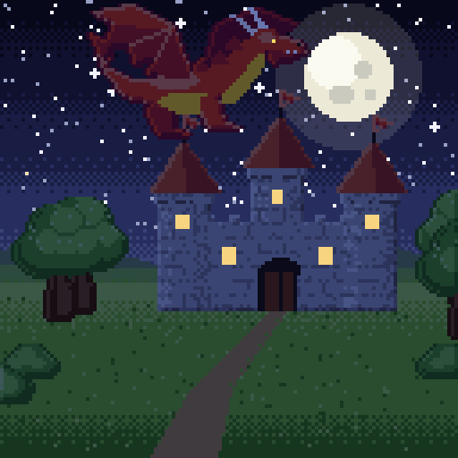
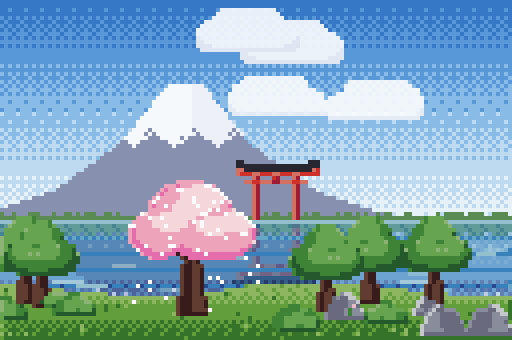
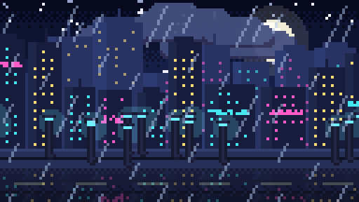
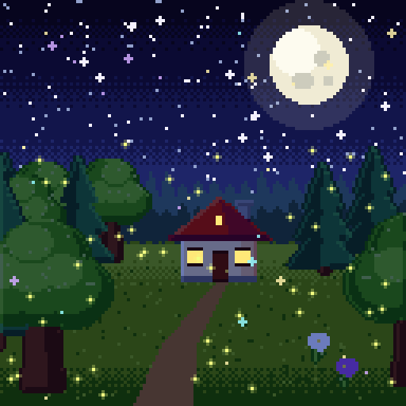
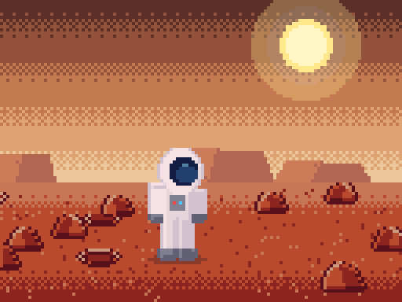
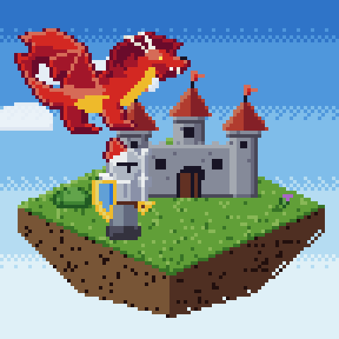
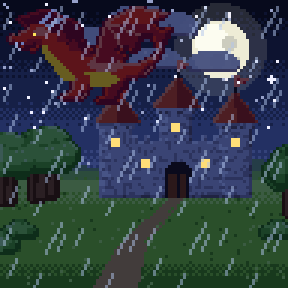
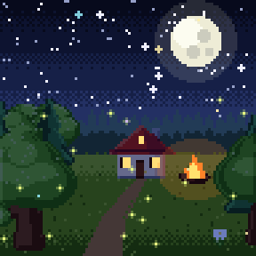
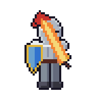
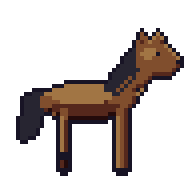

# PixelForge Studio

Generador de Pixel Art **por código**. Escribes una descripción («un dragón rojo volando sobre un castillo durante la noche»), la aplicación la convierte en una estructura compacta de datos (**PixelScene v1**: coordenadas, capas, índices de paleta) y un motor propio en JavaScript la dibuja en un Canvas. No hay filtros de pixelado ni modelos generativos de imágenes.

| | | |
|---|---|---|
|  |  |  |
|  |  |  |

Con animación (GIF exportado por la propia aplicación):

| | | | |
|---|---|---|---|
|  |  |  |  |

Todas las imágenes de `docs/examples/` las genera el modo offline (`npm run examples`). La escena del dragón a 128×128 ocupa **5,7 KB** de JSON.

## Cómo iniciarla

Requiere Node 20 o superior. El modo offline no necesita instalar nada:

```bash
cd pixelforge
```

```bash
npm start
```

Abre <http://localhost:8787>. Los módulos ES necesitan servirse por HTTP (no funciona abriendo `index.html` con `file://`). Cualquier servidor estático sirve para el modo offline; `npm start` añade además el backend del modo IA.

Es una PWA: desde Chrome (escritorio o Android) se puede instalar con «Instalar aplicación» y, tras la primera carga, funciona sin conexión.

### Modo IA (opcional)

```bash
npm install
```

```bash
cp .env.example .env
```

Escribe tu clave en `ANTHROPIC_API_KEY` dentro de `.env` y reinicia `npm start`. Los modos con IA del selector **Modo** se habilitan solo cuando el servidor detecta la clave. Sin clave la aplicación sigue funcionando completa en offline.

Hay dos modos con IA:

| Modo | Qué hace la IA | Salida del modelo | Cuándo usarlo |
|---|---|---|---|
| **Híbrido (IA interpreta)** | Traduce la descripción al catálogo del motor; el dibujo es local | Una especificación de ~100 tokens | Por defecto: entiende cualquier redacción e idioma a un coste mínimo |
| **IA (dibuja todo)** | Escribe la escena PixelScene completa | Miles de tokens | Cuando lo pedido no existe en el catálogo ni tiene sustituto razonable |

En el modo híbrido el modelo recibe la lista de los 79 sprites, entornos, clima y colores, y responde con una estructura restringida por esquema JSON (`src/ai/specSchema.js`). Si algo no está en el catálogo elige lo más parecido y lo declara («tigre → león naranja»), y ese aviso se muestra en la interpretación. Como el resultado es la misma especificación que produce el parser offline, VARIAR, las semillas y la edición por capas funcionan igual y **sin volver a llamar a la IA**; solo «Modificar la escena» hace otra llamada para interpretar la instrucción. El modelo de este modo se puede fijar aparte con `PIXELFORGE_INTERPRET_MODEL`.

- La clave vive únicamente en el servidor (`server/`); el navegador solo habla con `/api/interpret` y `/api/pixelscene`.
- El modelo (por defecto `claude-opus-5-5`, configurable con `PIXELFORGE_MODEL`) **no genera imágenes**: devuelve un JSON PixelScene que el motor local dibuja.
- La respuesta se sanea y valida en el servidor y otra vez en el cliente; si no es válida se hace un único reintento con los errores.
- Los endpoints solo aceptan peticiones del mismo origen y están limitados a 12 peticiones por minuto e IP.

> Los dos modos con IA están implementados y sus partes deterministas (saneado, validación, petición, flujo de interfaz con el backend simulado) tienen pruebas, pero **no se han ejecutado contra la API real** en el entorno donde se construyeron, porque no había clave disponible. La calidad de la interpretación del modelo está, por tanto, sin medir.

## Uso

1. **Describe la imagen** y pulsa **GENERAR** (Ctrl+Intro). Debajo aparece la *interpretación*: lo que el motor entendió, en texto y en forma compacta (`SUBJECT=dragon(red);SCENE=castle;LIGHT=night…`), y las palabras que no reconoció.
2. **VARIAR** muestra cuatro variaciones con otras semillas; **REGENERAR** repite con una semilla nueva. Con «fijar» activado, GENERAR reutiliza la semilla: la misma semilla produce siempre la misma imagen.
3. **Modificar la escena** acepta instrucciones como «conserva el castillo, cambia el cielo a púrpura y agrega una luna». Solo se regeneran las partes afectadas; el resto de capas —incluidas las que hayas editado a mano— se conserva.
4. **Panel de edición**: capas (mostrar, reordenar, opacidad, contorno, sombreado, duplicar, eliminar), paleta (cambiar un color actualiza toda la imagen porque todo se referencia por índice), luz (dirección, ambiente, dithering), exportación y el JSON editable.
5. **Lápiz, borrador y cuentagotas** para retoques píxel a píxel; se guardan en una capa propia.
6. **Guardar / Galería**: proyectos en IndexedDB, en tu dispositivo. Se pueden abrir, duplicar, renombrar, eliminar y exportar.

### Animación

El selector **Animación** (Reposo, Caminar, Atacar) genera un ciclo de 4 fotogramas. Si el prompt dice «caminando» o «atacando» se elige solo. Se anima:

- **Sprites**: paso alterno de piernas y brazos en personajes, paso en diagonal en cuadrúpedos, aleteo en dragón, pájaro, murciélago y mariposa, golpe de espada o conjuro de bastón en el ataque, respiración en reposo. Lo que vuela o flota se mece.
- **Ambiente**: lluvia y nieve que caen en bucle sin salto, estrellas que parpadean, brillos del agua, luciérnagas, destellos, llamas y relámpagos.

La barra del lienzo permite pausar y avanzar fotograma a fotograma. En **Exportar** aparecen **GIF animado** y **Tira de fotogramas** (PNG con los fotogramas en fila más un JSON con `fps` y tamaño de cuadro, para motores de juego).

La animación forma parte del formato: `an` indica fotogramas y velocidad, y solo las capas que se mueven guardan fotogramas extra (`fo`) o un desplazamiento por fotograma (`mv`). Una escena de 4 fotogramas ocupa alrededor de un 50 % más que la estática, no cuatro veces más.

Límites de la animación:
- Son ciclos procedurales sencillos de 4 fotogramas, no animación dibujada a mano; el paso de los personajes es de 1–2 píxeles a 48 px.
- «Atacar» solo tiene gesto propio en personajes con espada o bastón; el resto hace el ciclo de reposo.
- Las nubes y los astros no se mueven.
- El GIF tiene transparencia de 1 bit: las sombras semitransparentes se pierden al exportar con fondo transparente. La tira PNG las conserva.
- El modo «IA (dibuja todo)» no genera animaciones; el híbrido sí, porque dibuja el motor local.

### Exportación

- PNG a tamaño original o ampliado con factor entero (hasta 4096 px), siempre por vecino más cercano.
- PNG con fondo transparente (sin color de fondo ni capa de cielo).
- Hoja de sprites (sujetos, estructuras y sprites reutilizables) con su índice JSON; PNG de una capa suelta desde el panel de capas.
- `*.pixelscene.json` (la escena) y `*.pfproj.json` (proyecto completo: escena, prompt, opciones y especificación). Ambos se pueden volver a importar.

## PixelScene v1

```json
{"v":1,"w":64,"h":64,"pal":[[12,18,34],[35,48,80],[230,190,100]],"bg":0,
 "layers":[{"n":"sky","o":[["R",0,0,64,64,0],["E",42,12,8,8,2]]},
           {"n":"castle","o":[["R",12,30,40,22,1]]}]}
```

| Campo | Significado |
|---|---|
| `w`, `h` | Tamaño lógico, 8–256 px |
| `pal` | Paleta RGB (máx. 96). Todo color es un índice |
| `bg` | Índice de fondo, o `-1` transparente |
| `rmp` | Rampas de índices (oscuro → claro) para el sombreado |
| `q` | Paleta de cuantización final (opcional) |
| `fx` | `ld` dirección de la luz, `amb` luz ambiental `[r,g,b,%]`, `dth` dithering 0–3 |
| `an` | Animación (opcional): `n` fotogramas (2–12) y `fps` |
| `sprites` | Sprites reutilizables `{id:{w,h,o}}` |
| `layers` | Capas en orden de dibujo: `n` nombre, `k` parte, `v` visible, `a` opacidad, `sh` sombreado de borde, `ol` contorno (`-2` selectivo), `nl` emisiva, `f` bruma, `rf` reflejo, `o` operaciones, `fo` fotogramas siguientes (`o` es el 0), `mv` desplazamiento `[dx,dy]` por fotograma |

| Op | Parámetros | |
|---|---|---|
| `R` | `x,y,w,h,c` | rectángulo |
| `L` | `x1,y1,x2,y2,c` | línea |
| `E` | `cx,cy,rx,ry,c` | elipse rellena |
| `P` | `[x1,y1,…],c` | polígono relleno |
| `M` | `x,y,filas` | matriz de píxeles (`0-9a-zA-Z` = índices, `.` = vacío) |
| `S` | `id,x,y,flip` | instancia de sprite |
| `G` | `x,y,w,h,[c…],dir` | degradado tramado |
| `D` | `x,y,w,h,c,nivel` | trama de Bayer |
| `T` | `x,y,w,h,c,dens,seed` | textura de motas determinista |
| `B` | `x,y,w,h,id` | sprite en mosaico |
| `H` | `x,y,w,h,delta` | desplaza los píxeles por su rampa |

El último parámetro opcional de las operaciones de dibujo es el *modo* (1 = solo sobre píxeles opacos, 2 = solo sobre vacíos); `c = -1` borra. La definición formal y los límites están en `src/core/pixelScene.js`.

La validación comprueba JSON, dimensiones, cada índice de color, rangos de coordenadas, operaciones permitidas, estructura de capas y límites globales (8000 operaciones, 64 capas, 2 MB). No se usa `eval` ni `innerHTML` en ningún punto.

## Arquitectura

```
src/core        Motor: formato y validación, renderizador a búfer de índices,
                geometría entera, dithering de Bayer, luz por paleta, semillas
src/generator   Modo offline: vocabulario, parser, biblioteca de sprites
                procedurales, generadores de entorno, compositor por partes
src/editor      Operaciones puras de capas, color, historial y retoque
src/export      PNG (canvas.toBlob), GIF animado, hojas de sprites, proyectos
src/storage     IndexedDB (con respaldo en memoria)
src/ai          Especificación para el modelo y cliente del backend
src/ui          Interfaz
server          Servidor estático + adaptador de IA
tests           Pruebas unitarias (node:test) y de navegador (tests/e2e)
tools           Render a PNG desde Node, ejemplos e iconos
```

Decisiones que se apartan de la estructura propuesta, y por qué:

- **Sin Web Workers.** Renderizar 256×256 tarda unos milisegundos; un worker añadiría complejidad sin mejora medible.
- **`vocabulary.js` y `src/ai/` añadidos.** El diccionario se separa del parser para ampliarlo sin tocar lógica; la especificación del modelo la comparten cliente y servidor.
- **El núcleo no toca el DOM.** `renderer.js` devuelve RGBA puro, lo que permite probarlo en Node y generar los ejemplos sin navegador.
- **La luz y la paleta restringida se aplican al renderizar**, sobre la paleta. Cambiar de día a noche o a 4 verdes no modifica ninguna capa.

## Límites del modo offline

El motor offline **no entiende lenguaje libre**: reconoce un vocabulario cerrado en español e inglés (79 sprites procedurales, 13 entornos, relieve, hora, clima, astros, 14 colores) y lo compone con reglas. Lo que no reconoce lo ignora y lo dice; no finge haberlo dibujado. La lista completa está en la aplicación, en «¿Qué entiende el modo offline?».

- Las relaciones espaciales («detrás de», «a la izquierda») no se interpretan; la colocación sigue reglas fijas de composición.
- Los sprites son procedurales y estilizados: sirven como base, no sustituyen a un artista.
- El estilo isométrico usa una isla en perspectiva con los objetos como figuras frontales, no modelos isométricos reales.
- El borrador solo elimina retoques hechos con el lápiz, no píxeles de las capas generadas (para eso, oculta o elimina la capa).
- A 16×16 y 32×32 las escenas completas pierden legibilidad; a esos tamaños funciona mejor el estilo «Personajes y sprites».

Para ampliar el vocabulario: añade sinónimos en `src/generator/vocabulary.js`; para un objeto nuevo, registra su constructor en `src/generator/spriteLibrary.js`.

## Pruebas

```bash
npm test
```

69 pruebas unitarias: parser, modo híbrido, animación y codificador GIF (verificado con un decodificador independiente), validación de PixelScene, geometría, renderizador, generador (todas las combinaciones de estilo, resolución y bioma, y los 79 sprites), edición parcial, exportación y adaptador de IA.

```bash
npm run test:e2e
```

Prueba en navegador real con Playwright (debe estar instalado): arranque, generación, nitidez del escalado, semillas, variaciones, edición por instrucción, capas, paleta, luz, lápiz, exportación PNG/JSON, galería con IndexedDB, vista móvil, animación (reproducción, GIF, tira) y modo híbrido con el backend de IA simulado.
