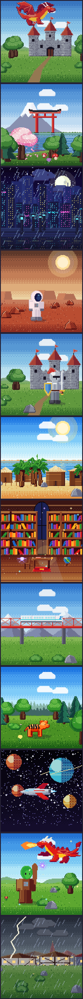

# Benchmark de 12 escenas

Parámetros comunes: 128×128, estilo 16-bit, semilla 7. Columnas de la comparativa: procedural.

## Resumen medido

| Motor | Interpretación (elementos esperados) | Elementos visibles en la imagen | Control de calidad | Tiempo medio de interpretación |
|---|---|---|---|---|
| Procedural | 21/21 (100 %) | 8/8 (100 %) | 96/96 | 0 ms |

> Aviso: estas 12 descripciones usan palabras que el vocabulario procedural conoce, en parte porque se amplió pensando en ellas. Por eso su interpretación es completa aquí; no indica que entienda cualquier redacción. La comprensión de frases nuevas se mide con «Evaluar este modelo» (panel IA local), que usa sinónimos fuera del vocabulario. «Elementos visibles» solo cuenta sujetos y estructuras: la vegetación comparte capa y no se puede medir por separado.

> Solo se ejecutó el motor procedural. Para comparar con Ollama: `node tools/benchmark.mjs <modelo> [modelo…]` con Ollama en marcha.

## Detalle por escena

### Un dragón volando sobre un castillo

Esperado: dragon, castle

- **procedural:** interpretación 2/2 · visibles 2/2 · QC 9/9 · 35 colores · 2 ms + 48 ms

### Un bosque japonés con un lago y un cerezo

Esperado: cherry, feature:lake

- **procedural:** interpretación 2/2 · visibles 0/0 · QC 9/9 · 40 colores · 1 ms + 49 ms

### Una ciudad cyberpunk de noche

Esperado: biome:cyber

- **procedural:** interpretación 1/1 · visibles 0/0 · QC 6/6 · 31 colores · 0 ms + 8 ms

### Un astronauta sobre Marte

Esperado: astronaut, biome:mars

- **procedural:** interpretación 2/2 · visibles 1/1 · QC 9/9 · 23 colores · 0 ms + 9 ms

### Un caballero medieval frente a un castillo

Esperado: knight, castle

- **procedural:** interpretación 2/2 · visibles 2/2 · QC 9/9 · 44 colores · 0 ms + 11 ms

### Una aldea tropical frente al mar

Esperado: town:tropical

- **procedural:** interpretación 1/1 · visibles 0/0 · QC 6/6 · 29 colores · 0 ms + 5 ms

### El interior de una biblioteca fantástica

Esperado: interior:library

- **procedural:** interpretación 1/1 · visibles 0/0 · QC 6/6 · 37 colores · 0 ms + 4 ms

### Un tren futurista atravesando montañas

Esperado: train, feature:mountains

- **procedural:** interpretación 2/2 · visibles 1/1 · QC 9/9 · 34 colores · 0 ms + 6 ms

### Un tigre en una selva

Esperado: tiger, biome:forest

- **procedural:** interpretación 2/2 · visibles 1/1 · QC 9/9 · 31 colores · 0 ms + 21 ms

### Una nave espacial rodeada de planetas

Esperado: spaceship, sky:planet

- **procedural:** interpretación 2/2 · visibles 1/1 · QC 9/9 · 33 colores · 0 ms + 8 ms

### Una batalla fantástica entre criaturas

Esperado: battle, creatures:2

- **procedural:** interpretación 2/2 · visibles 0/0 · QC 9/9 · 46 colores · 0 ms + 8 ms · Añado contendientes para la batalla: dragón y trol.

### Una ciudad medieval durante una tormenta

Esperado: town:medieval, weather:storm

- **procedural:** interpretación 2/2 · visibles 0/0 · QC 6/6 · 35 colores · 0 ms + 4 ms
